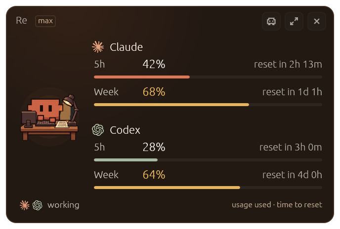
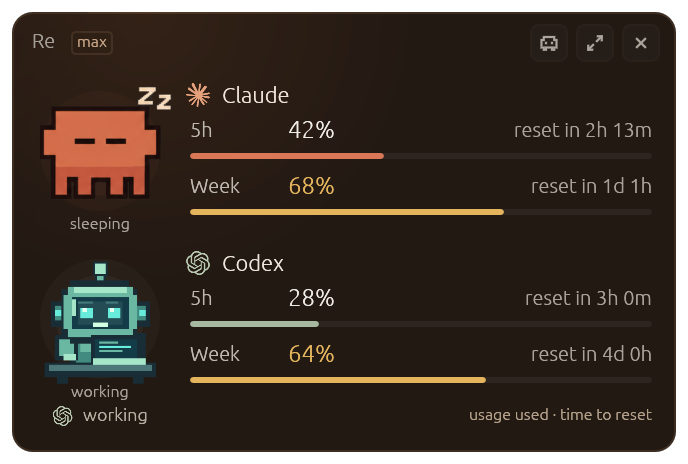
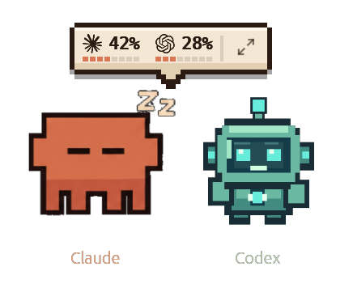

# Clauddy Dual

**Two assistants. Four limits. One glance.**

Stop interrupting your work to check whether Claude Code or Codex is about to run out. Clauddy Dual gives both a permanent spot on your Mac: live usage readings, reset countdowns, and two tiny companions that react as you work.

<p align="center">
  
</p>
<p align="center"><sub>App screenshot with illustrative test readings—not a live account.</sub></p>

## Know your limits. Keep your momentum.

You have enough to think about when you're building with AI. Tracking two different rate-limit schedules shouldn't be another job.

Clauddy Dual shows you **what you've used and when it resets**, without opening a menu, switching a tab, or breaking concentration.

| What matters | Claude Code | Codex |
| --- | --- | --- |
| Session / 5-hour usage | Percentage used + reset countdown | Percentage used + reset countdown |
| Weekly usage | Percentage used + reset countdown | Percentage used + reset countdown |
| On-screen character | Original orange Clauddy | Original mint-green robot companion |
| Activity | Its own working, sleeping, and limit moods | Its own working, resting, and limit moods |

**No guesswork:** unavailable or expired readings appear as unavailable, never as a fake 0%. Percentages show **usage consumed**, not percentage remaining.

## Two characters. Two independent moods.

The orange Clauddy might be asleep while the Codex robot is hard at work. Each reacts to its own activity and whichever usage window is closest to its limit—even when the *weekly* limit is tighter than the 5-hour one.

<p align="center">
  
</p>

Prefer something smaller? Switch to **pet-only mode**: both characters float together, and hovering brings up a quick usage glance.

<p align="center">
  
</p>

The widget is draggable, always on top, and built with **native Rust + egui**—no browser-based dashboard to keep open. Expand it for the original detailed breakdown, or keep the compact four-limit view in sight.

## Get running on macOS

This fork is currently **source-install only**: no downloadable binary release or notarized installer is published yet. It has been built and tested on an Apple Silicon Mac.

**You'll need:** macOS, [Rust/Cargo](https://rustup.rs/), and your existing Claude Code and/or Codex installation.

```bash
git clone https://github.com/manynames3/clauddy-dual.git
cd clauddy-dual
./scripts/install-dual-macos.sh
```

The script builds a signed local app, installs **Clauddy Dual.app** in `~/Applications`, and launches it. It keeps a timestamped backup before replacing an older Clauddy Dual build. Your original Clauddy installation is not replaced.

**Connect your providers:** In the app's Settings, authorize your Claude account for its account-level rate-limit percentages and enable Codex monitoring. The first Claude reading needs its own OAuth authorization—even if Claude Code is already signed in.

If you see **“awaiting reading,”** that provider has not delivered a valid quota reading yet. Check its connection first; Codex data from local logs/app-server can be delayed or unavailable.

## What it reads—and what it doesn't

- **Claude Code:** Account-level rate limits via its authorized usage connection, plus optional local Claude Code activity/log data.
- **Codex:** Existing local Codex data and app-server/log readings. No invented percentages or reset times.
- **Storage:** App settings and account state live on your machine in `~/.claude-usage-monitor/`. Provider authentication and usage requests still go to the corresponding services. See [the upstream privacy and architecture notes](docs/design/01-architecture.md).
- **Updates:** This customized build deliberately **does not install upstream updates** that would remove the dual-provider UI. Rebuild from this repository instead.

This is an independent project, **not affiliated with Anthropic or OpenAI**. Quota reporting depends on what each service makes available; a reading can occasionally be stale.

## Build, test, and customize

```bash
cd native
cargo fmt --check
cargo clippy --release --all-targets -- -D warnings
cargo test --release
```

The screenshot fixtures live in [`native/tests/snapshots/`](native/tests/snapshots/). The Codex character's reproducible art generator is [`tools/generate_codex_pet.py`](tools/generate_codex_pet.py). Technical design details live in [`docs/design/`](docs/design/) and [`README-DUAL.md`](README-DUAL.md).

**Looking for `bunx clauddy` or the original root `install.sh`?** Those are from the upstream project and do **not** install this customization. Use the source-install command above for Clauddy Dual.

## Credits & license

Clauddy Dual builds on [**Clauddy** by Renato Augusto](https://github.com/renatoaug/claude-usage-monitor). The original native app, Claude pet, usage readers, and many UI components come from that MIT-licensed project. This fork adds the simultaneous four-limit dashboard and the independently animated Codex companion.

[REA](https://github.com/morluto/rea) was used to analyze the inherited JavaScript launcher. The actual dual-provider UI changes were made directly to the open-source Rust app; REA is **not** a runtime dependency.

Licensed under the [MIT License](LICENSE). Original attribution and license are preserved.
