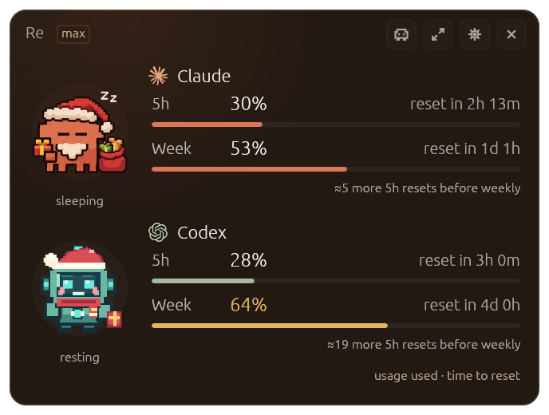
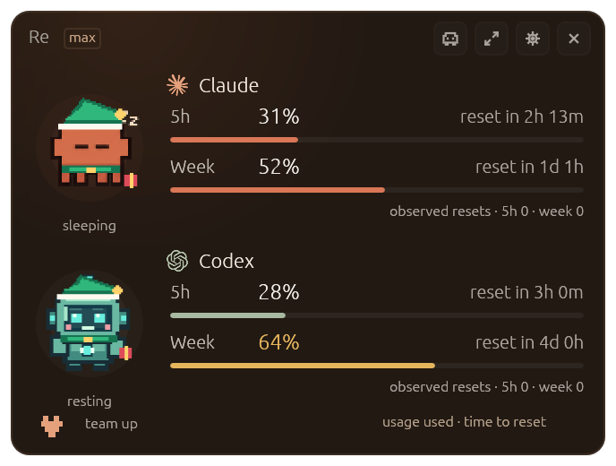
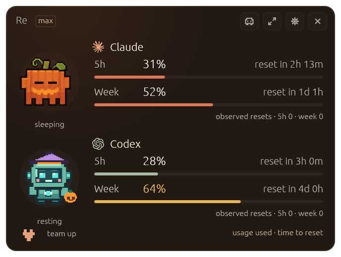
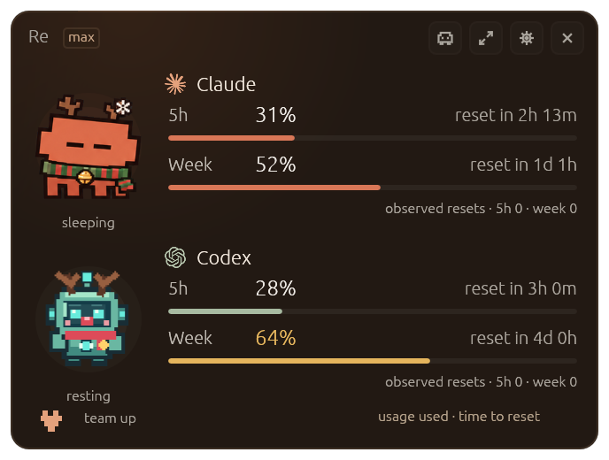
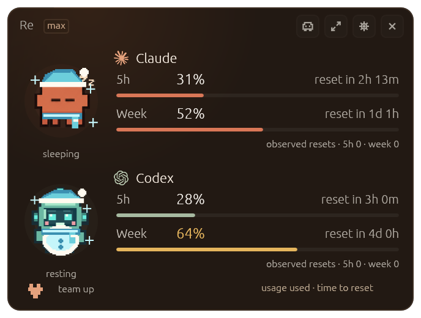

# QuotaPals

**Two assistants. Four limits. One glance.**

Stop interrupting your work to check whether Claude Code or Codex is about to run out. QuotaPals gives both a permanent spot on your Mac: live usage readings, reset countdowns, and two tiny companions that react as you work.

<p align="center">
  
</p>
<p align="center"><sub>App screenshot with illustrative test readings—not a live account.</sub></p>

## Why I Built QuotaPals

I use Codex and Claude Code heavily, and I kept running into two frustrations.

**First, I wanted to see my usage limits without having to look for them.**

CodexBar is a solid tool, but checking my 5-hour and weekly limits requires extra clicks. I wanted something that could sit in the corner of my screen and tell me, at a glance, exactly how much usage I have left and when it resets.

**Second, I was tired of losing momentum when I hit a usage limit.**

I had previously built [CodexReset](https://github.com/boyso/codex-reset) to solve that problem. When a session stops because you've reached your limit, it can automatically resume once your usage resets. No babysitting. No coming back hours later just to type "continue."

**QuotaPals combines both ideas into one simple desktop companion.**

See your limits. Know when they reset. Automatically pick up where you left off.

**Less checking. Less waiting. More building.**

## Know your limits. Keep your momentum.

You have enough to think about when you're building with AI. Tracking two different rate-limit schedules shouldn't be another job.

QuotaPals shows you **what you've used and when it resets**, without opening a menu, switching a tab, or breaking concentration.

| What matters | Claude Code | Codex |
| --- | --- | --- |
| Session / 5-hour usage | Percentage used + reset countdown | Percentage used + reset countdown |
| Weekly usage | Percentage used + reset countdown | Percentage used + reset countdown |
| On-screen character | Original orange Clauddy | Original mint-green robot companion |
| Activity | Its own working, sleeping, and limit moods | Its own working, resting, and limit moods |

**No guesswork:** unavailable or expired readings appear as unavailable, never as a fake 0%. Percentages show **usage consumed**, not percentage remaining.

## Two characters. Two independent moods.

The orange Clauddy might be asleep while the Codex robot is hard at work. Each reacts to its own activity and whichever usage window is closest to its limit—even when the *weekly* limit is tighter than the 5-hour one.

<p align="center">
  
</p>

Prefer something smaller? Switch to **pet-only mode**: both characters float together, and hovering brings up a quick usage glance.

<p align="center">
  
</p>

The widget is draggable, always on top, and built with **native Rust + egui**—no browser-based dashboard to keep open. Expand it for the original detailed breakdown, or keep the compact four-limit view in sight.

## Christmas outfits, expressive pets, and the macOS menu bar

Give your work companions some personality. Click the **gear beside X → Look**.

- **Seasonal collections:** Switch between **Auto**, **Base**, **Xmas**, **Boo** (Halloween), and **Snow** (winter). Within Xmas, pick **Santa**, **Elf**, or **Deer**. Both pets dress to match; Claude's underlying costumes come from MIT-licensed Clauddy, while the Codex robot and its costume sheets are original additions. The new snow-day set includes a puffy snowman-style Codex robot.
- **Lives in:** **Float** (desktop widget), **Bar** (macOS menu bar), or **Both**. The menu lists separate usage windows and their next resets.
- **Resize the entire widget:** Drag the diagonal grip at the **bottom-right corner** of the floating window and **release to apply** your new scale (it stays steady while you drag), or click it for a 10% increase. For precise adjustments, open **gear → Look → Scale** (75–250%, in 10% steps). On macOS, **⌘+ / ⌘=** and **⌘−** change the scale, and **⌘0** returns to 100%. Fonts, character sprites, progress bars, and click targets scale together. Your choice is remembered across launches. The window automatically fits the selected scale rather than keeping a huge invisible canvas.
- **Click to interact:** Click either pet to cycle a heart, wave, and dance. Click **team up** in the compact footer (or the little heart between pets in pet-only mode) to cycle **high-five, gift exchange, and nap buddies**. Animations stay within the pet area; one short reaction label appears in the footer rather than covering meters or characters.
- **Automatic emotions:** Busy pets work, low-energy pets sleep, nearing the limit makes them nervous, and a confirmed 5-hour or weekly reset triggers a labeled celebration. Completing an active task makes that specific companion cheer. Reactions are purely visual; they don't issue model requests.

<p align="center">
  
</p>
<p align="center"><sub>Christmas mode with illustrative values; choose Xmas in Look to enable it any time.</sub></p>

<p align="center">
  
  
  
  
</p>

<sub>The screenshots show test data rather than your live account.</sub>

Both providers now show **independent 5-hour and weekly reset countdowns**, plus **observed reset totals** tracked separately for each window. The counts start at zero when QuotaPals first begins recording; they increase only after a genuine quota decrease following a reset deadline. They are not the number of future resets remaining, which the providers do not publish. Offline or missed resets may not be counted.

## Keep moving after your limit resets (opt-in)

You shouldn't have to watch a clock just to get back to work. QuotaPals adds **Auto-continue after reset** for both Claude Code and Codex, adapted from the recovery workflow in [CodexReset by BOYSO](https://github.com/boyso/codex-reset).

In the compact widget, click the **gear next to X**, open **Resume**, and turn on **Claude Code**, **Codex**, or both. Each switch is **off by default**. QuotaPals checks the local session history for a turn that **ended in a confirmed usage-limit error**, then waits for fresh quota data showing that a new usage window has opened. Only then does it send a short “Continue where you left off” message to the affected session.

- **Codex:** Detects failed `usageLimitExceeded` turns in the local read-only Codex history database and resumes through `codex exec resume`.
- **Claude Code:** Detects explicit API-limit failures in local Claude Code session logs, then uses `claude --resume` in non-interactive mode.
- **Safety:** No auto-continuation without opt-in. Completed or actively continued turns aren't intentionally retried. Resumptions are recorded to prevent duplicate sends across restarts. QuotaPals does not bypass permissions.
- **Availability:** QuotaPals must remain running, the relevant CLI must be installed, and both the error and recovery must be verifiable. Some providers or failure formats may not be detectable. **A dispatched command is not proof the session completed successfully.**

**Already running CodexReset?** If its auto-continue is enabled, QuotaPals **defers Codex recovery** to avoid duplicate turns. CodexReset only resumes conversations that are both **selected** and **currently usage-paused**; if no selected conversation qualifies, neither app will resume anything. Select the intended paused conversations in CodexReset, or disable its auto-continue to hand control to QuotaPals. Do not enable both engines for the same conversations. QuotaPals' **Settings → Resume** tab now shows the current reason for waiting. CodexReset's chat-selection and app-server/GUI fallback features are **not yet replicated** here.

The local activity log is stored at `~/.claude-usage-monitor/auto-continue.log`. Automated turns can consume usage and, within the CLI's normal permissions, make project changes. This feature is new and should be monitored until validated against a real reset.

## Get running on macOS

This fork is currently **source-install only**: no downloadable binary release or notarized installer is published yet. It has been built and tested on an Apple Silicon Mac.

**You'll need:** macOS, [Rust/Cargo](https://rustup.rs/), and your existing Claude Code and/or Codex installation.

```bash
git clone https://github.com/manynames3/quotapals.git
cd quotapals
./scripts/install-quotapals-macos.sh
```

The script builds a signed local app, installs **QuotaPals.app** in `~/Applications`, and launches it. It keeps a timestamped backup before replacing an older QuotaPals build. Your original Clauddy installation is not replaced.

**Connect your providers:** In the app's Settings, authorize your Claude account for its account-level rate-limit percentages and enable Codex monitoring. The first Claude reading needs its own OAuth authorization—even if Claude Code is already signed in.

If you see **“awaiting reading,”** that provider has not delivered a valid quota reading yet. Check its connection first; Codex data from local logs/app-server can be delayed or unavailable.

## What it reads—and what it doesn't

- **Claude Code:** Account-level rate limits via its authorized usage connection, plus optional local Claude Code activity/log data.
- **Codex:** Existing local Codex data and app-server/log readings. No invented percentages or reset times.
- **Storage:** App settings and account state live on your machine in `~/.claude-usage-monitor/`. Provider authentication and usage requests still go to the corresponding services. See [the upstream privacy and architecture notes](docs/design/01-architecture.md).
- **Updates:** This customized build deliberately **does not install upstream updates** that would remove the dual-provider UI. Rebuild from this repository instead.

This is an independent project, **not affiliated with Anthropic or OpenAI**. Quota reporting depends on what each service makes available; a reading can occasionally be stale.

## Build, test, and customize

```bash
cd native
cargo fmt --check
cargo clippy --release --all-targets -- -D warnings
cargo test --release
```

The screenshot fixtures live in [`native/tests/snapshots/`](native/tests/snapshots/). The Codex character's reproducible art generator is [`tools/generate_codex_pet.py`](tools/generate_codex_pet.py). Technical design details live in [`docs/design/`](docs/design/) and [`FORK-NOTES.md`](FORK-NOTES.md).

**Looking for `bunx clauddy` or the original root `install.sh`?** Those are from the upstream project and do **not** install this customization. Use the source-install command above for QuotaPals.

## Credits & license

QuotaPals builds on [**Clauddy** by Renato Augusto](https://github.com/renatoaug/claude-usage-monitor). The original native app, Claude pet, usage readers, and many UI components come from that MIT-licensed project. This fork adds the simultaneous four-limit dashboard and the independently animated Codex companion.

The auto-continue workflow was adapted from [**CodexReset** by BOYSO](https://github.com/boyso/codex-reset) (MIT). It inspired the recovery gating and read-only pause detection; QuotaPals adds its own Rust worker and a Claude Code CLI path. See [third-party notices](THIRD_PARTY_NOTICES.md).

[REA](https://github.com/morluto/rea) was used to analyze the inherited JavaScript launcher. The actual dual-provider UI changes were made directly to the open-source Rust app; REA is **not** a runtime dependency.

Licensed under the [MIT License](LICENSE). Original attribution and license are preserved.
